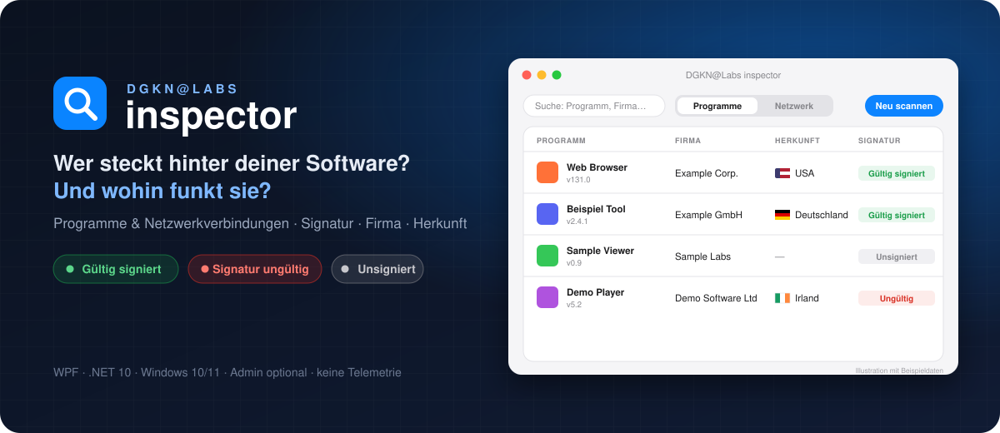
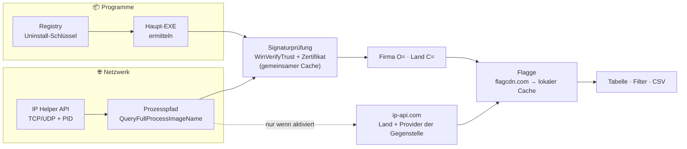

<p align="center">
  
</p>

<p align="center">
  
  
  
  
  
  
  
</p>

```text
  ____   ____ _  ___   _       _          _
 |  _ \ / ___| |/ / \ | |     | |    __ _| |__  ___
 | | | | |  _| ' /|  \| |  _  | |   / _` | '_ \/ __|
 | |_| | |_| | . \| |\  | (_|) | |__| (_| | |_) \__ \
 |____/ \____|_|\_\_| \_|  @  |_____\__,_|_.__/|___/

                 I N S P E C T O R
     WHO MADE IT · IS IT SIGNED · WHERE DOES IT TALK
```

# Jedes Programm auf deinem PC. Mit Absender. Und Ziel.

**DGKN@Labs inspector** beantwortet zwei Fragen in einem Fenster:

| 📦 **Programme** | 🌐 **Netzwerk** |
|---|---|
| *Was ist installiert – und wer hat es signiert?* | *Welcher Prozess spricht gerade mit wem?* |
| Alle installierten Programme mit **Authenticode-Signatur**, **Firma laut Zertifikat** und **Herkunftsland** samt Flagge. | Alle aktiven **TCP/UDP-Verbindungen** mit Prozess, PID, Remote-Adresse und der **Signatur der Prozess-EXE**. Auf Wunsch zusätzlich Land und Provider der Gegenstelle. |

Beides läuft **lokal**, ohne Installation und ohne Hintergrunddienst. Die EXE ist eine einzelne Datei.

[Features](#-features) · [Schnellstart](#-schnellstart) · [So funktioniert es](#-so-funktioniert-es) · [Datenschutz](#-datenschutz) · [Grenzen](#-was-die-anzeige-bedeutet--und-was-nicht) · [Bauen](#-selbst-bauen) · [Lizenz](#-lizenz)

> **Hervorgegangen aus zwei Tools:** *DGKN@Labs inspector 1.0* (Programme) und *DGKN@Labs netstat 1.0*
> (Verbindungen). Version 2.0 vereint beide und verknüpft sie: Die Signaturprüfung gibt es
> jetzt auch für jede Netzwerkverbindung.

---

## ✨ Features

### 📦 Programme

| | Feature | Was du bekommst |
|---|---|---|
| 🗂️ | **Vollständige Liste** | Liest alle drei Uninstall-Zweige der Registry (Maschine 64-Bit, Maschine 32-Bit, aktueller Benutzer). Systemkomponenten, Hotfixes und Updates werden ausgeblendet, Duplikate zusammengeführt. |
| 🔏 | **Signaturprüfung** | Echte Windows-Vertrauensprüfung über `WinVerifyTrust`. Erkennt eingebettete **und** Katalog-Signaturen. |
| 🏢 | **Firma laut Zertifikat** | Kommt aus dem `O=`-Feld des Zertifikats, nicht aus dem frei wählbaren Publisher-Text der Registry. |
| 🌍 | **Herkunftsland + Flagge** | Wird aus dem `C=`-Feld des Zertifikats gelesen, mit deutschem Ländernamen. |
| 🖼️ | **Echte Icons** | Werden direkt aus EXE- oder ICO-Dateien gezogen. |
| 🎯 | **Filter** | **Nur unsigniert** oder **Nur Auffällige** (unsigniert + ungültig). |

### 🌐 Netzwerk

| | Feature | Was du bekommst |
|---|---|---|
| 🔌 | **Live-Verbindungen** | TCP, TCP6, UDP und UDP6 direkt aus der IP Helper API (`iphlpapi.dll`). Das ist dieselbe Quelle wie `netstat -ano`, nur ohne externen Prozess. |
| 🧩 | **Prozess statt PID** | Zeigt Name, vollständigen Pfad und Ordner jedes Prozesses. |
| 🔏 | **Signatur je Prozess** | *Neu in 2.0.* Jede Prozess-EXE wird einmal geprüft, so fallen unsignierte Programme mit Internetverbindung sofort auf. |
| 🔄 | **Auto-Aktualisierung** | Alle 5 Sekunden, ohne Flackern oder Scroll-Sprung. Pausiert, solange der Tab nicht sichtbar ist. |
| 🎯 | **Filter** | **Nur externe**, **Lauscher ausblenden**, **Nur Auffällige** |
| 🌍 | **Länderabfrage (optional)** | Zeigt Land, Flagge und Provider der Gegenstelle. **Standardmäßig aus**, Details unter [Datenschutz](#-datenschutz). |
| 🛡️ | **Admin-Modus** | Startet die App auf Knopfdruck mit Adminrechten neu. Dann sind die Pfade und Signaturen aller Prozesse sichtbar, auch die von Systemdiensten. |

### In beiden Tabs

🔎 Live-Suche über alle Spalten · 📂 **Doppelklick** öffnet den Explorer mit markierter EXE · ⇩ **CSV-Export** der gefilterten Ansicht (UTF-8, `;`-getrennt, öffnet direkt korrekt in Excel) · ⚡ Prüfungen laufen im Hintergrund, die Oberfläche bleibt flüssig

---

## 🚀 Schnellstart

1. Die neueste `DGKN@Labs inspector.exe` unter **[Releases](../../releases)** herunterladen.
2. Doppelklicken. Fertig: keine Installation, keine .NET-Runtime nötig.

> **Windows SmartScreen** meldet beim ersten Start möglicherweise „Unbekannter Herausgeber“,
> weil die EXE nicht mit einem kostenpflichtigen Code-Signing-Zertifikat signiert ist.
> Über **Weitere Informationen → Trotzdem ausführen** startest du sie. Wer auf Nummer sicher gehen will,
> vergleicht die SHA-256-Prüfsumme aus dem Release oder [baut die App selbst](#-selbst-bauen).

**Tipps**

- Im Tab **Programme** zeigt **Nur Auffällige** alles, was ohne gültige Signatur installiert ist.
- Im Tab **Netzwerk** zeigen **Nur externe** und **Nur Auffällige** zusammen unsignierte Prozesse, die gerade ins Internet verbunden sind.
- In der Suche funktionieren auch Länder, Ports und PIDs, zum Beispiel `China`, `:443` oder `4711`.

---

## 🧠 So funktioniert es



**Signatur bewerten**

| Badge | Bedeutung |
|---|---|
| ✓ **Gültig signiert** | Windows vertraut der Signatur, egal ob sie eingebettet oder über den Windows-Katalog vorliegt. |
| ⚠ **Signatur ungültig** | Es ist ein Zertifikat vorhanden, aber Windows vertraut ihm nicht: Die Datei ist verändert, das Zertifikat abgelaufen oder die Kette nicht vertrauenswürdig. |
| **Unsigniert** | Es gibt weder ein eingebettetes Zertifikat noch eine Katalog-Signatur. |
| **—** | Es gab nichts zu prüfen: Die EXE wurde nicht gefunden oder der Prozesspfad ist ohne Adminrechte nicht lesbar. |

**Die richtige EXE finden (Programme).** Die Registry verrät selten, welche Datei „das Programm“ ist.
Der inspector sucht deshalb in dieser Reihenfolge:

1. `DisplayIcon`, falls es auf eine `.exe` zeigt.
2. Die EXEs in `InstallLocation`, im Icon-Ordner und im Deinstaller-Ordner, jeweils oben und eine Ebene tiefer.
3. Dabei werden Deinstaller, Updater, Crash-Handler und Helper aussortiert. Bevorzugt wird die EXE, deren Name im Programmnamen vorkommt, sonst die größte.

---

## 🔐 Datenschutz

Der inspector ist **rein lesend** und hat **keine Telemetrie, kein Konto und keinen Hintergrunddienst**.
Er verändert nichts an deinen Programmen oder Netzwerkeinstellungen.

Nur in diesen zwei Fällen verlassen Daten den PC:

| Dienst | Wann | Was wird gesendet | Standard |
|---|---|---|---|
| [flagcdn.com](https://flagcdn.com) | wenn ein Land angezeigt wird | nur der **zweistellige Ländercode** (z. B. `de`); jede Flagge wird **einmal** geladen und dann gecacht | an |
| [ip-api.com](https://ip-api.com) | nur wenn du im Netzwerk-Tab **🌍 Länderabfrage** einschaltest | die **öffentlichen Remote-IP-Adressen** deiner Verbindungen; private und lokale Adressen werden nie gesendet | **aus** |

> ⚠️ **Zur Länderabfrage:** Der kostenlose Endpunkt von ip-api.com läuft über **unverschlüsseltes HTTP**
> und ist laut Anbieter **nur für nicht-kommerzielle Nutzung** freigegeben (Limit: 15 Sammelanfragen pro Minute).
> Die übertragenen IP-Adressen verraten, mit welchen Diensten dein PC gerade verbunden ist.
> Deshalb ist die Funktion standardmäßig ausgeschaltet.

**Lokal gespeichert** wird nur der Flaggen-Cache unter `%LOCALAPPDATA%\DGKNInspector\flags`.
CSV-Dateien entstehen ausschließlich, wenn du selbst exportierst.

---

## ⚖️ Was die Anzeige bedeutet – und was nicht

> **Eine gültige Signatur heißt: Die Datei stammt unverändert von dieser Firma. Sie heißt nicht,
> dass die Software harmlos ist.** Umgekehrt ist „Unsigniert“ kein Malware-Beweis, denn viele
> Open-Source- und Hobby-Tools sind schlicht nicht signiert.
> Der inspector ist ein **Transparenz-Werkzeug, kein Virenscanner**.

- **„Herkunft“ (Programme)** ist das Land im Zertifikat, also der Sitz der signierenden Firma. Das ist nicht unbedingt der Ort, an dem entwickelt wird.
- **„Herkunft“ (Netzwerk)** ist der Standort der Gegenstelle laut ip-api.com. Bei CDNs und Cloud-Diensten ist das oft nur der nächste Rechenzentrumsknoten.
- **Katalog-signierte Dateien** (viele Windows-Bestandteile) werden als gültig erkannt. Firma und Land lassen sich aber nur aus eingebetteten Zertifikaten lesen.
- **Keine Sperrlistenprüfung.** Widerrufene Zertifikate werden nicht online geprüft, das hält die App schnell und offline-fähig.
- **Ohne Adminrechte** sind Pfad und Signatur mancher System- und Dienstprozesse nicht lesbar und erscheinen als `—`. Abhilfe schafft 🛡 **Als Admin**.
- **Die EXE-Auswahl ist eine Heuristik.** Welche Datei geprüft wurde, steht in der CSV-Spalte `EXE`.
- **Nur klassisch installierte Programme.** Portable Tools ohne Registry-Eintrag und die meisten Store-/MSIX-Apps tauchen im Programme-Tab nicht auf. Im Netzwerk-Tab erscheinen sie trotzdem, sobald sie eine Verbindung aufbauen.

---

## 🛠️ Selbst bauen

**Voraussetzung:** Windows mit dem [.NET 10 SDK](https://dotnet.microsoft.com/download).

```powershell
git clone https://github.com/dogenc/DGKN-Labs-Inspector.git
cd DGKN-Labs-Inspector

# Zum Entwickeln starten
dotnet run

# Einzelne, eigenständige EXE (inkl. .NET-Runtime, ca. 65 MB)
dotnet publish -c Release -r win-x64 --self-contained true -p:PublishSingleFile=true
```

Die fertige Datei liegt danach in `bin\Release\net10.0-windows\win-x64\publish\`.

### Projektstruktur

```text
DGKN-Labs-Inspector/
├── App.xaml                      Farben, Schrift, gemeinsame Styles (Buttons, Tabs, Tabellen, Badges)
├── MainWindow.xaml(.cs)          Kopfzeile, Tab-Umschalter, Zähler, Admin-Neustart
├── Views/
│   ├── IInspectorView.cs         Gemeinsame Schnittstelle der Tabs
│   ├── ProgramsView.xaml(.cs)    Tab „Programme“
│   └── NetworkView.xaml(.cs)     Tab „Netzwerk“
├── Models/
│   ├── ProgramRow.cs             Zeile: installiertes Programm
│   └── ConnectionRow.cs          Zeile: Netzwerkverbindung
├── Services/
│   ├── InstalledPrograms.cs      Registry lesen + Haupt-EXE ermitteln
│   ├── SignatureInspector.cs     WinVerifyTrust + Zertifikat (O=, C=)
│   ├── SignatureBadge.cs         Gemeinsamer Signatur-Cache + Badge-Farben
│   ├── IpHelper.cs               TCP/UDP-Tabellen aus iphlpapi.dll
│   ├── ProcessResolver.cs        PID → Name, Pfad, Ordner
│   ├── GeoIpService.cs           Optionale Länderabfrage (ip-api.com, Batch + Cache)
│   ├── FlagService.cs            Flaggen laden & lokal cachen
│   ├── IconExtractor.cs          Icons aus EXE/ICO
│   ├── Countries.cs              ISO-Ländercode → deutscher Name
│   └── AppServices.cs            Geteilte Dienste, Admin-Check, CSV-Helfer
├── assets/banner.svg             README-Banner
├── tools/make_icon.ps1           Erzeugt appicon.ico
└── app.manifest                  asInvoker, Per-Monitor-DPI v2
```

### Technik

| Bereich | Umsetzung |
|---|---|
| UI | WPF, `DataGrid` mit gemeinsamen Zellvorlagen, `ICollectionView`-Filter |
| Signatur | P/Invoke `wintrust.dll` → `WinVerifyTrust` (`WINTRUST_ACTION_GENERIC_VERIFY_V2`), Ergebnis pro Pfad gecacht |
| Zertifikat | `X509Certificate.CreateFromSignedFile` → Subject-DN (`O`, `CN`, `C`) |
| Verbindungen | P/Invoke `iphlpapi.dll` → `GetExtendedTcpTable` / `GetExtendedUdpTable` (IPv4 + IPv6) |
| Prozesse | `QueryFullProcessImageNameW` mit `PROCESS_QUERY_LIMITED_INFORMATION` |
| Icons | P/Invoke `shell32.dll` → `ExtractIconEx` |
| Netzwerk | `HttpClient` mit 8 s Timeout; ip-api-Batch (max. 100 IPs/Anfrage); Flaggen-Datei-Cache |

---

## 🗺️ Ideen für später

- [ ] Detailansicht mit vollständiger Zertifikatskette, Gültigkeit und Zeitstempel
- [ ] Offline-Länderdatenbank (z. B. DB-IP Lite) statt Online-Abfrage
- [ ] Optionale Online-Sperrlistenprüfung
- [ ] Store-/MSIX-Apps und Autostart-Einträge
- [ ] Dark Mode
- [ ] Vergleich zweier Scans („Was ist neu seit letzter Woche?“)

---

## 📄 Lizenz

[MIT](LICENSE) © DGKN@Labs

Externe Dienste zur Laufzeit: Flaggenbilder von [flagcdn.com](https://flagcdn.com) (Flagpedia),
Geo-Daten optional von [ip-api.com](https://ip-api.com). Für beide gelten deren eigene Nutzungsbedingungen.
Der inspector bündelt keine Daten oder Bilder dieser Dienste.

<p align="center">
  <sub>Gebaut von <b>DGKN@Labs</b> · OBSERVE · VERIFY · UNDERSTAND</sub>
</p>
